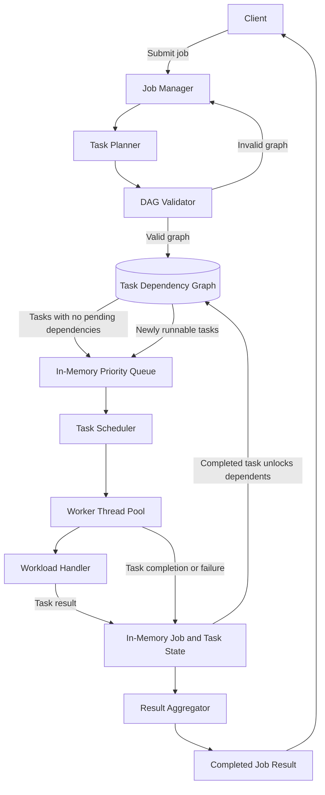
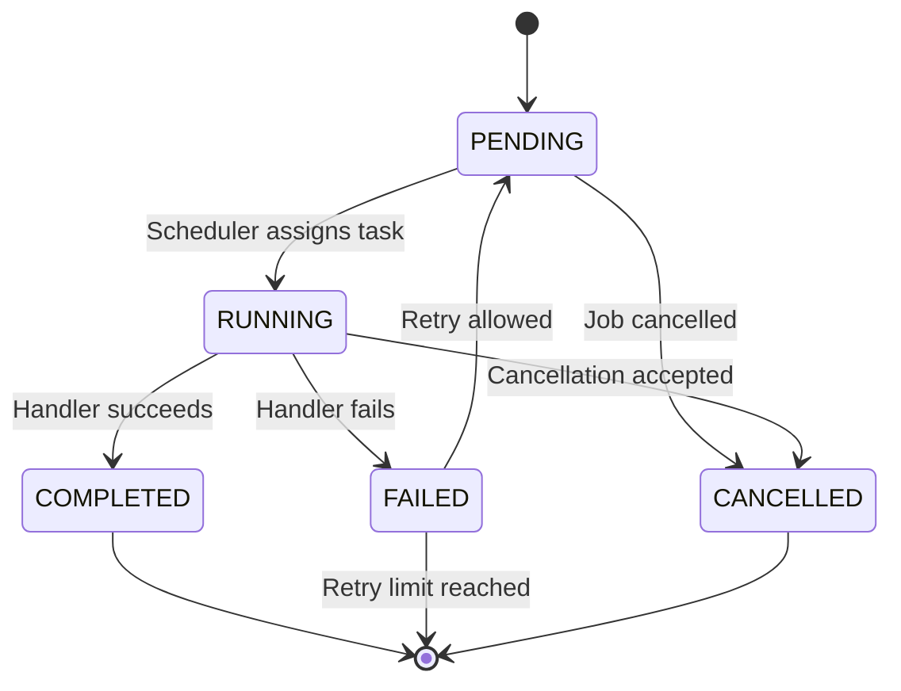
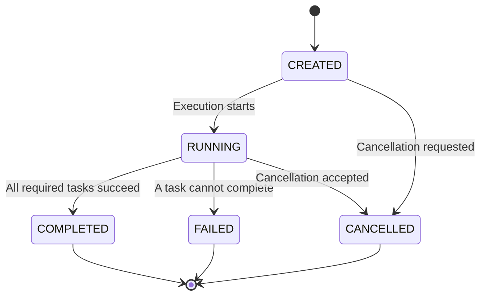

# Stage 1 High-Level Design: Single-Process Engine

## 1. Purpose

Stage 1 implements the first working version of Aglet as a single-process
engine. A job is divided into tasks, task dependencies are represented as a
directed acyclic graph, runnable tasks are placed in an in-memory priority
queue, and a thread pool executes them.

This stage establishes the core execution model before introducing processes,
network communication, persistence, or production infrastructure.

## 2. Scope

### In scope

- Job and task models
- Task dependency graph
- DAG validation
- Runnable-task detection
- In-memory priority queue
- Thread-pool execution
- Task and job state tracking
- Workload-handler abstraction
- Result collection and aggregation

### Out of scope

- Multiple processes
- Network communication
- PostgreSQL or other durable storage
- RabbitMQ
- Task leases and fencing tokens
- Worker registration and heartbeats
- Coordinator recovery
- Distributed deployment

## 3. Stage 1 Architecture



## 4. Component Responsibilities

### Client

Submits a job definition and receives the final job result or execution
status.

### Job Manager

- Creates and tracks jobs.
- Validates the overall job request.
- Starts and stops job execution.
- Determines the final job status.

### Task Planner

- Divides the job into tasks.
- Assigns dependencies between tasks.
- Builds the task dependency graph.
- Identifies the initial runnable tasks.

### DAG Validator

- Detects cycles.
- Rejects invalid task references.
- Ensures the task graph is executable.
- Prevents execution when the dependency definition is invalid.

### Task Dependency Graph

Represents task relationships. An edge from task A to task B means that task B
cannot become runnable until task A completes successfully.

The graph is used to:

- Find tasks with no pending dependencies.
- Unlock dependent tasks after completion.
- Validate that the workflow is acyclic.

### In-Memory Priority Queue

Stores tasks that are ready to execute. The queue determines which runnable
task is selected next according to the stage's priority policy.

The queue does not contain tasks whose dependencies are still incomplete.

### Task Scheduler

- Takes runnable tasks from the queue.
- Submits tasks to the thread pool.
- Applies the configured scheduling policy.
- Coordinates queue access with task state updates.

### Worker Thread Pool

The thread pool represents the workers for Stage 1. These are threads inside
the same process, not independent worker processes.

Each thread:

1. Receives a task.
2. Invokes the workload handler.
3. Reports success or failure.
4. Releases capacity for another task.

### Workload Handler

Executes workload-specific logic without knowing about scheduling or graph
management.

Examples include CSV parsing, transaction validation, and transaction
aggregation.

### In-Memory Job and Task State

Tracks the current state of jobs and tasks during execution. This state is
lost when the process stops because durable persistence is intentionally out
of scope for this stage.

### Result Aggregator

Collects completed task results and produces the final job result after all
required tasks complete.

## 5. End-to-End Execution Flow

1. The client submits a job definition.
2. The Job Manager creates the job.
3. The Task Planner divides the job into tasks.
4. The DAG Validator validates the dependency graph.
5. The graph and task state are stored in memory.
6. Tasks with no pending dependencies are added to the priority queue.
7. The Scheduler selects a runnable task.
8. The Scheduler submits the task to the thread pool.
9. A worker thread executes the workload handler.
10. The task is marked completed or failed.
11. A completed task unlocks its dependent tasks.
12. Newly runnable tasks are added to the priority queue.
13. The Result Aggregator combines task results.
14. The Job Manager marks the job as completed or failed.
15. The final result is returned to the client.

## 6. Task State Flow



Only tasks in the `PENDING` state with all dependencies completed may enter
the ready queue.

## 7. Job State Flow



## 8. Graph and Queue Interaction

The task graph and priority queue have separate responsibilities:

```text
Task graph:
  Determines whether a task is eligible to run.

Priority queue:
  Determines which eligible task runs next.
```

When a task completes:

1. The graph is examined for dependent tasks.
2. Each dependent task checks whether all prerequisites completed.
3. Eligible tasks transition to runnable state.
4. Eligible tasks are inserted into the priority queue.
5. The Scheduler selects tasks according to priority.

The queue must never be used as a substitute for dependency validation.

## 9. Concurrency Boundary

The process contains one shared execution state and multiple worker threads.
Access to shared state must be coordinated.

The main shared resources are:

- Job and task state
- Task dependency graph
- Ready queue
- Result collection
- Active worker count

The design must ensure that:

- A task is not assigned to two threads at the same time by the scheduler.
- A dependent task is not released before its prerequisites complete.
- Job completion is evaluated after all required task updates are visible.
- Results are aggregated safely.

## 10. Failure Handling in Stage 1

Stage 1 handles failures within the process:

- A task failure is recorded.
- A retryable failure may return the task to the ready queue.
- A task that reaches its retry limit becomes permanently failed.
- A permanently failed task causes the job to fail unless the job policy says
  otherwise.
- A cancelled job prevents pending tasks from being scheduled.

Process crashes, worker-process failures, stale results, and recovery after
restart are deferred to later stages.

## 11. Stage 1 Success Criteria

Stage 1 is complete when the engine can:

- Execute a valid DAG of tasks using multiple threads.
- Reject cyclic task graphs.
- Avoid running tasks before their dependencies complete.
- Apply a deterministic priority policy.
- Track task and job state transitions.
- Handle task failure and bounded retries.
- Aggregate task results correctly.
- Produce the same result as a trusted sequential implementation.
- Demonstrate the behaviour through automated tests.
